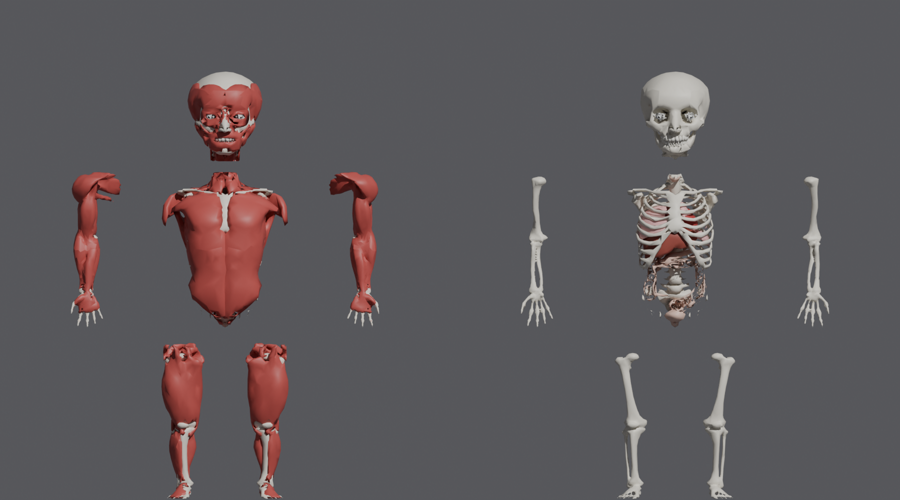
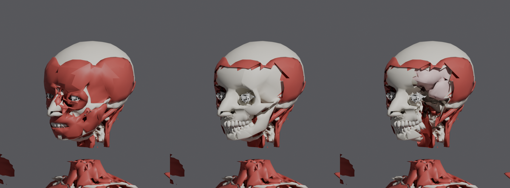

# Anatomie réaliste (intérieur du corps)

Quand une bouteille en verre arrache la peau (tête, torse ou jambe), on voit **l'intérieur réel du corps** :
- **niveau 1** : la peau part, les muscles apparaissent ;
- **niveau 2** : les muscles partent à cet endroit, l'os apparaît (crâne, côtes, os de la jambe) ;
- **niveau 3** : sur la tête, un morceau du crâne part et le cerveau apparaît.

Les modèles viennent de **Z-Anatomy**. Ils sont rangés dans `assets/anatomy/`, avec un fichier FBX par partie du corps R6.




## Importer les modèles dans Studio (une seule fois)

1. Dans Studio : **Explorer** → `ReplicatedStorage` → clic droit → **Insert Object** → **Folder**, nommé **`Assets`**.
   Dedans, crée un autre Folder nommé **`Anatomy`**.
2. Menu **Home** (ou **Avatar**) → **Import 3D** → choisis `assets/anatomy/Anatomy_Head.fbx`.
   Dans la fenêtre d'import :
   - **File Dimensions / Scale unit** : laisse la valeur par défaut. Le jeu s'adapte tout seul à la taille.
   - Garde les objets séparés : décoche **Merge Meshes** si l'option est proposée.
   - Clique **Import**.
3. Le modèle apparaît dans le Workspace sous le nom **`Anatomy_Head`**. Glisse-le dans `ReplicatedStorage > Assets > Anatomy`.
   S'il porte un autre nom, renomme-le exactement `Anatomy_Head`.
4. Recommence pour les 5 autres fichiers :
   - `Anatomy_Torso`
   - `Anatomy_RightArm`
   - `Anatomy_LeftArm`
   - `Anatomy_RightLeg`
   - `Anatomy_LeftLeg`
5. **Ne supprime pas** les pièces **`Bounds`**, **`MarkUp`** et **`MarkFront`** dans chaque modèle. Le jeu s'en sert pour trouver le haut, l'avant et la taille.
6. Publie le jeu (**File → Publish**) pour que les maillages soient envoyés sur Roblox.

Rojo ne touche pas à `ReplicatedStorage > Assets` : ce dossier reste dans le fichier du jeu.

Sans ces modèles, le jeu marche quand même : la tête garde l'ancienne version simple, et le torse et les jambes ne montrent rien.

## Comment ça marche (pour info)

- Le **serveur** décide de la profondeur de chaque blessure avec les attributs `Torn_<Partie>_<Côté>`, de 1 à 3.
  Exemples : `Torn_Head_Front`, `Torn_Torso_Left`, `Torn_RightLeg_Back`.
- Le **client** (`src/client/Combat/Anatomy.luau`) remplace la partie touchée par :
  - une **peau en petites tuiles**, avec la couleur de peau, le t-shirt, le pantalon et le visage du joueur dessinés dessus ;
  - **dessous**, les modèles d'anatomie.
  Une blessure cache les tuiles de peau autour du point touché. Plus profonde, elle cache aussi les morceaux de muscle à cet endroit, puis le morceau de crâne.
- Tout part au kill ou à la réapparition.

## Refaire les modèles (optionnel)

Le script `tools/anatomy/build_anatomy.py` refait les FBX à partir de Z-Anatomy. Il utilise Blender en Python, sans fenêtre.

```bash
python -m venv venv && venv/bin/pip install bpy==5.3.0
git clone --depth 1 https://github.com/Z-Anatomy/The-blend   # puis dézipper Z-Anatomy.zip
venv/bin/python tools/anatomy/build_anatomy.py <Z-Anatomy/Startup.blend> assets/anatomy
venv/bin/python tools/anatomy/preview_anatomy.py assets/anatomy apercu.png front
```

Pour changer le nombre de triangles par couche (qualité contre performance), modifie `BUDGET` en haut du script.

## Licence : à créditer dans le jeu

Les modèles sont dérivés de **Z-Anatomy** et sont donc sous licence **CC BY-SA 4.0**. Il faut **créditer** Z-Anatomy, par exemple dans un écran « Credits » ou dans la description du jeu :

> 3D anatomy: Z-Anatomy (CC BY-SA 4.0), based on BodyParts3D © The Database Center for Life Science (CC BY-SA 2.1 JP).

Les reins et l'oreille interne de Z-Anatomy ont été **exclus**, car ils sont sous une licence non commerciale.

⚠️ Gore réaliste : sur Roblox, remplis le **questionnaire de maturité** du jeu en conséquence (17+). Tu peux aussi tout couper avec `SKIN_TEAR = false` dans `Config.luau`.
