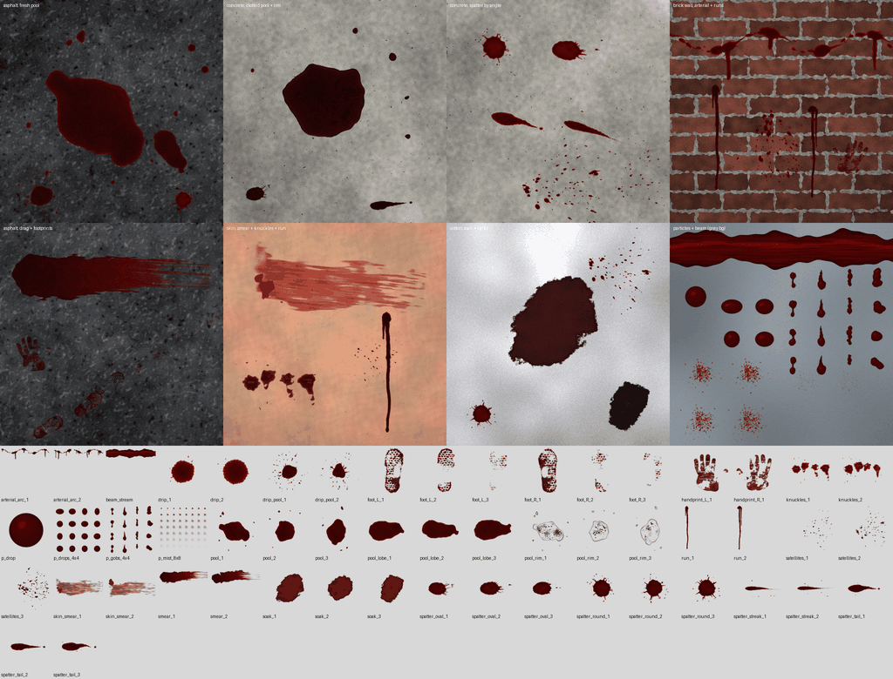
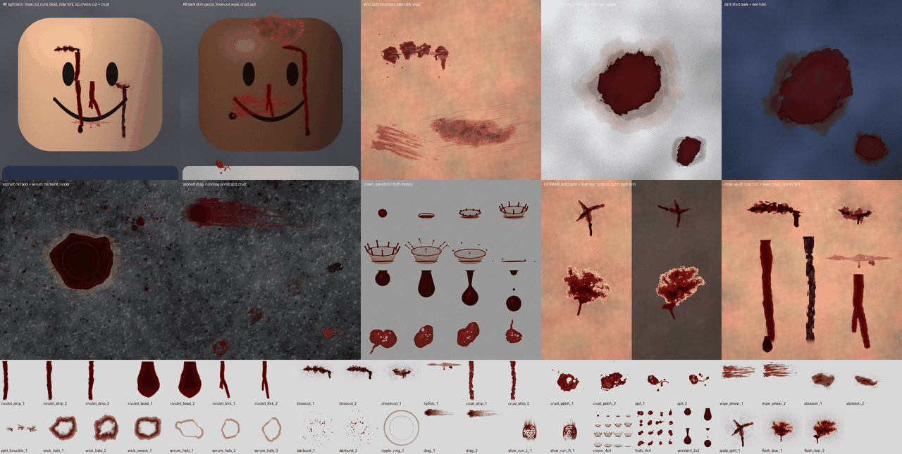

# Les images du sang (une seule fois)

Le sang est beaucoup plus réaliste avec ses images : vraies formes de taches (bords festonnés, épines, queues, gouttelettes satellites), flaques avec un bord fin, coulures, traînées, empreintes de pas et de mains, tissus imbibés, gouttes qui volent.
**Sans elles, le jeu marche quand même** : il dessine le sang avec des formes simples (ovales, disques). Tu peux les importer dans n'importe quel ordre, une catégorie à la fois.



## Comment elles marchent

- Les images sont **en gris** : blanc = film de sang très fin, gris foncé = sang épais. Le jeu les **teinte** avec les couleurs de `Config.Blood.PALETTE` (rouge vif quand c'est frais, puis rouge sombre, puis brun-noir quand ça sèche). C'est pour ça qu'elles paraissent grises dans le Gestionnaire de contenus : c'est normal.
- Les taches « directionnelles » (ovales, queues, traînées, satellites, arcs) **vont vers la droite** de l'image (+X). Le jeu les tourne dans le sens du mouvement de la goutte.
- Les empreintes (pieds, mains) ont les **orteils / doigts vers le haut** de l'image.
- Elles sont fabriquées par `tools/blood/make_blood_textures.py` (Python, numpy + scipy + Pillow). Pour les refaire : `python3 tools/blood/make_blood_textures.py` puis `python3 tools/blood/preview.py` (depuis la racine du repo). Si tu les refais, il faut les ré-importer et recoller les ID.

## Les fichiers (`assets/blood/`, 53 images, ~2,7 Mo)

| Fichiers | Taille | Ce que c'est | Clé dans `IMAGES` |
|---|---|---|---|
| `spatter_round_1..3` | 512 | Goutte tombée presque à la verticale : tache ronde, épines, gouttelettes autour | `spatterRound` |
| `spatter_oval_1..3` | 512 | Goutte arrivée en biais (40-70°) : ovale, épines vers l'avant | `spatterOval` |
| `spatter_tail_1..3` | 512 | Goutte très en biais (15-40°) : « point d'exclamation » avec queue | `spatterTail` |
| `spatter_streak_1..2` | 512 | Goutte rasante (< 15°) : longue traînée perlée | `spatterStreak` |
| `satellites_1..3` | 512 | Nuage de fines gouttelettes (40, 90, 150 gouttes) | `satellites` |
| `drip_1..2` | 256 | Goutte tombée d'une plaie (environ 1 m) | `drip` |
| `drip_pool_1..2` | 512 | Gouttes tombées sur du sang mouillé (quelqu'un saigne sans bouger) | `dripPool` |
| `pool_1..3` | 1024 | Flaque : bord fin plus clair, centre épais | `pool` |
| `pool_rim_1..3` | 1024 | Même contour que `pool_<n>` : auréole qui sèche, sérum, caillots | `poolRim` |
| `pool_lobe_1..3` | 512 | Langue de sang qui s'ajoute quand la flaque coule vers la pente | `poolLobe` |
| `run_1..2` | 256×1024 | Coulure sur un mur / la peau (du haut vers le bas) | `run` |
| `smear_1..2` | 1024×512 | Traînée quand on traîne un corps (vers la droite) | `smear` |
| `handprint_L_1`, `handprint_R_1` | 256 | Empreinte de main gauche / droite | `handL`, `handR` |
| `foot_L_1..3`, `foot_R_1..3` | 256 | Semelle gauche / droite : 1 = pleine, 2 = partielle, 3 = trace | `footL`, `footR` |
| `soak_1..3` | 512 | Sang imbibé dans un t-shirt / pantalon | `soak` |
| `skin_smear_1..2` | 512 | Film fin essuyé sur la peau | `skinSmear` |
| `knuckles_1..2` | 256 | Sang sur les jointures du poing | `knuckles` |
| `arterial_arc_1..2` | 1024×256 | Jet d'artère sur un mur : vague de taches + coulures | `arterialArc` |
| `p_drop` | 128 | Une goutte en vol (particule) | `pDrop` |
| `p_drops_4x4` | 1024 | Goutte qui oscille en tombant (16 images) | `pDrops4x4` |
| `p_gobs_4x4` | 1024 | 16 paquets / filaments de sang (gros jets) | `pGobs4x4` |
| `p_mist_8x8` | 1024 | Fine bruine qui s'étale (64 images) | `pMist8x8` |
| `beam_stream` | 1024×256 | La « corde » de sang du jet d'artère (se répète vers la droite) | `beamStream` |

`preview.png` n'est **pas** à importer : c'est juste l'aperçu.

## Importer dans Studio

1. Ouvre le jeu dans Roblox Studio.
2. **Fenêtre → Gestionnaire de contenus** (*Window → Asset Manager*).
3. Clique **Importation en bloc** (*Bulk Import*), puis choisis toutes les images de `assets/blood/` **sauf `preview.png`** (Ctrl+A puis Ctrl+clic sur `preview.png` pour la retirer). Attends que la modération les accepte (elles apparaissent dans le dossier *Images*).
4. Pour chaque image : **clic droit → Copier l'ID de la ressource** (*Copy Asset ID*). Attention : il faut l'ID de l'**image**, pas celui d'un décalque.
5. Colle l'ID dans `src/shared/Config.luau`, dans `Blood.IMAGES`, à la bonne place. Chaque liste suit l'ordre des numéros des fichiers :

```lua
IMAGES = table.freeze({
	spatterRound = table.freeze({ 0, 0, 0 }), -- spatter_round_1, _2, _3
	...
	footL = table.freeze({ 0, 0, 0 }), -- foot_L_1 (pleine), _2 (partielle), _3 (trace)
	pool = table.freeze({ 0, 0, 0 }), -- pool_1..3
	poolRim = table.freeze({ 0, 0, 0 }), -- pool_rim_1..3 (même ordre que pool !)
	...
}),
```

   Par exemple, si `spatter_round_2.png` a l'ID `123456789` : `spatterRound = table.freeze({ 0, 123456789, 0 })`.
   **0 = pas encore importée** : le jeu prend une autre image de la même liste, ou les formes simples si toute la liste est à 0.
6. `pool_<n>` et `pool_rim_<n>` vont **par paires** (même contour) : remplis toujours les deux au même numéro.
7. Lance une partie test (F5) et frappe un mannequin pour voir le sang. Puis **File → Publish to Roblox**.

## Si ça ne rend pas bien

- **Le sang paraît rose** : ce n'est pas les images. Baisse d'abord la brillance (`gloss` dans `Config.Blood.PROFILES`), pas les couleurs.
- **Une image reste invisible** : vérifie que tu as collé l'ID de l'**image** (pas du décalque) et qu'elle a passé la modération.
- **Le jet d'artère est de travers** (corde verticale au lieu de suivre le jet) : préviens le développeur, `beam_stream` est dessinée pour que la corde suive la longueur du Beam (axe X de l'image).

⚠️ Gore réaliste : remplis le **questionnaire de maturité** du jeu en conséquence. `Config.Blood.ENABLED = false` coupe tout le sang.

## Nouvelles images (v2) : les détails

41 images **en plus** (~1,8 Mo), faites par le même script (`python3 tools/blood/make_blood_textures.py assets/blood v2`, aperçu : `python3 tools/blood/preview.py --v2`). Elles ajoutent les coulures sur le visage (avec la goutte au bout), les coupures (arcade, pommette), la croûte qui sèche, les crachats, les éraflures, les auréoles mouillées sur les vêtements, le sérum autour des vieilles flaques, les éclaboussures en couronne, les traînées de corps, et deux blessures extrêmes pour les finishers.



- **Les 53 anciennes images ne changent pas** : ne les ré-importe pas, leurs ID restent bons.
- Les nouvelles clés sont dans `Config.Blood.IMAGES`, toutes à **0** (= pas encore importée). Tant qu'une image vaut 0, le jeu emprunte une image proche déjà importée (`Config.Blood.IMAGE_FALLBACK`, par exemple une coulure du visage prend `run`), ou n'affiche pas ce détail (couronne, ondulation, mousse, goutte pendante).
- **Importe d'abord le groupe 1**, c'est lui qui se voit le plus en combat.
- Même règles qu'avant : images en gris teintées par le jeu, directionnelles vers la droite (+X), coulures et empreintes du haut vers le bas. Les planches (`crown_4x4`, `froth_4x4`, `pendant_2x2`) sont des grilles d'images pour les particules (4×4 ou 2×2).
- **Exception** : `flesh_tear_1..2` est **en couleur** (peau, graisse jaune, muscle, sang). À afficher avec la couleur **blanche** (`Color3.new(1, 1, 1)`), jamais teintée en rouge.

### Groupe 1 (le plus visible)

| Fichiers | Taille | Ce que c'est | Clé dans `IMAGES` | En attendant (0) |
|---|---|---|---|---|
| `rivulet_strip_1..3` | 128×512 | Coulure sur la peau (sans la goutte du bout) : centre foncé, bords fins, petits renflements où elle s'est arrêtée | `rivuletStrip` | `run` |
| `rivulet_bead_1..2` | 128 | La goutte au bout d'une coulure, vue de face | `rivuletBead` | `drip` |
| `rivulet_fork_1..2` | 256×512 | Coulure qui se sépare en 2-3 branches (autour de la bouche) | `rivuletFork` | `run` |
| `browcut_1..2` | 256×128 | Coupure de l'arcade (la coupure du boxeur) : fente foncée, lèvres de peau gonflées, sang qui déborde en bas | `browCut` | `skinSmear` |
| `lipfilm_1` | 256×64 | Film de sang sur la lèvre du bas, avec 2-3 gouttes qui pendent | `lipFilm` | `skinSmear` |
| `crust_strip_1..2` | 128×512 | Coulure séchée : croûte craquelée, mate | `crustStrip` | `run` |
| `spit_1..2` | 256 | Crachat de sang avec des bulles et un filet de salive | `spit` | `drip` |
| `crown_4x4` | 1024 (16 images) | Goutte qui s'écrase : couronne qui monte, lance des gouttelettes, retombe | `crown4x4` | rien |
| `ripple_ring_1` | 256 | Onde sur une flaque quand une goutte tombe dedans | `rippleRing` | rien |
| `starburst_1..2` | 512 | Gouttelettes en étoile autour d'une flaque où quelqu'un saigne sans bouger | `starburst` | `satellites` |
| `wick_halo_1..2` | 512 | Auréole autour d'une tache sur un t-shirt : la zone mouillée (1,2× la tache `soak`) et la frange pâle où le plasma est allé plus loin (1,5×) | `wickHalo` | `soak` |

### Groupe 2

| Fichiers | Taille | Ce que c'est | Clé dans `IMAGES` | En attendant (0) |
|---|---|---|---|---|
| `cheekcut_1` | 256×128 | Coupure de la pommette en croissant, plus gonflée | `cheekCut` | `skinSmear` |
| `wipe_smear_1..2` | 512×256 | Sang essuyé avec le dos de la main (traces des jointures) | `wipeSmear` | `skinSmear` |
| `crust_patch_1..2` | 256 | Plaque de sang séché, craquelée | `crustPatch` | `skinSmear` |
| `abrasion_1..2` | 512 | Peau râpée sur le bitume : rayures, points de sang, gravier (teinte `RAW`) | `abrasion` | `skinSmear` |
| `split_knuckle_1` | 256 | Jointures ouvertes à force de frapper (teinte `RAW`) | `splitKnuckle` | `knuckles` |
| `wick_weave_1` | 512 | Auréole sur un tissu synthétique (s'étale le long des fils) | `wickWeave` | `soak` |
| `serum_halo_1..3` | 512 | Anneau jaune pâle autour d'une vieille flaque (va **par paires** avec `pool_1..3`, même numéro) | `serumHalo` | rien |
| `drag_1..2` | 1024×256 | Corps traîné / qui glisse : départ chargé, stries du tissu | `drag` | `smear` |
| `shoe_run_L_1`, `shoe_run_R_1` | 256 | Empreinte de course : l'avant du pied seulement, glissé vers l'avant | `shoeRunL`, `shoeRunR` | `footL`, `footR` |
| `froth_4x4` | 1024 (16 images) | Paquets de sang mousseux (crachat, nez qui souffle) | `froth4x4` | `p_mist_8x8` |
| `pendant_2x2` | 512 (4 images) | Goutte qui pend, s'étire, se détache (moignons) | `pendant2x2` | `p_drops_4x4` |

### Blessures extrêmes (bonus, pas encore utilisées par le code)

| Fichiers | Taille | Ce que c'est | Clé dans `IMAGES` |
|---|---|---|---|
| `scalp_split_1` | 256 | Cuir chevelu / front éclaté en étoile (coup de batte, tête contre le sol) | `scalpSplit` (sinon `browCut`) |
| ~~`flesh_tear_1..2`~~ | 512 | **NE PAS IMPORTER** : refusée par la modération Roblox (avertissement sur le compte). `fleshTear` reste à 0. | — |

Pour importer : pareil qu'au-dessus (Gestionnaire de contenus → Importation en bloc), en choisissant **seulement les nouvelles images** (pas `preview.png` ni `preview_v2.png`), puis colle chaque ID dans `Config.Blood.IMAGES` à la bonne place (ordre des numéros). `serum_halo_<n>` va toujours avec `pool_<n>`.

Astuce : importe aussi les images des bleus (`Config.Injuries.BRUISE_IMAGES`, encore à 0) : les yeux au beurre noir apparaissent alors et encadrent les nouvelles coupures.

### La nuit, la pluie

- **Nuit** (`Lighting.ClockTime` avant 6 h 30 ou après 18 h 30) : le sang frais fonce et brille
  plus (dans le noir, on voit le sang à son reflet). Pour que ce reflet existe : `Lighting.Technology
  = Future` et `Lighting.EnvironmentSpecularScale` au moins **0,5**.
- **Pluie** : pas de météo sur cette branche, donc pas de sang dilué. Quand une météo existera, lire
  `workspace:GetAttribute("Weather") == "Rain"` dans `BloodAge` / `BloodPool` (bord rose qui s'étale
  vers le bas, flaques qui ne sèchent pas).

### Réglages de réalisme (à connaître en testant)

- **Premier coup de poing sur un visage intact** (pas de bleu, pas encore saigné, coup normal) : presque rien. La giclée est réduite à 45 % et, au mieux (4 fois sur 10, coup de face), un petit filet de sang d'une narine qui s'arrête en 6 à 12 s. Ensuite chaque coup qui fait saigner allonge un peu les saignements de nez (jusqu'à ×1,5) : le visage « s'ouvre » au fil du combat.
- **Empreintes de pas** : chaque pas garde 70 % du sang du précédent (`WORLD.FOOT_DECAY = 0.7`, réel : 60-75 %), environ 7 empreintes puis plus rien.
- **Sang sur un t-shirt** : la tache fraîche est cramoisie (`PALETTE.FABRIC_SOAK`), entourée d'une zone mouillée rouge sombre (`PALETTE.FABRIC_WET`) puis d'une frange rose pâle. Sur un t-shirt sombre, ça se voit surtout comme une zone plus foncée et rougeâtre.

## ⚠️ Modération Roblox

Roblox modère chaque image importée. `flesh_tear_2` (chair ouverte en couleur) a été **refusée** et a valu un avertissement au compte. Règle pour la suite :

- **jamais d'image de chair, d'organe ou de plaie ouverte réaliste** : ces éléments se font avec des pièces (Parts / meshes) dans le jeu, pas avec des images ;
- les images de sang restent des **taches en niveaux de gris** teintées par le jeu (éclaboussures, flaques, coulures), qui passent la modération ;
- si tu as importé `flesh_tear_1`, il vaut mieux la **supprimer** de tes ressources pour éviter un deuxième avertissement.
