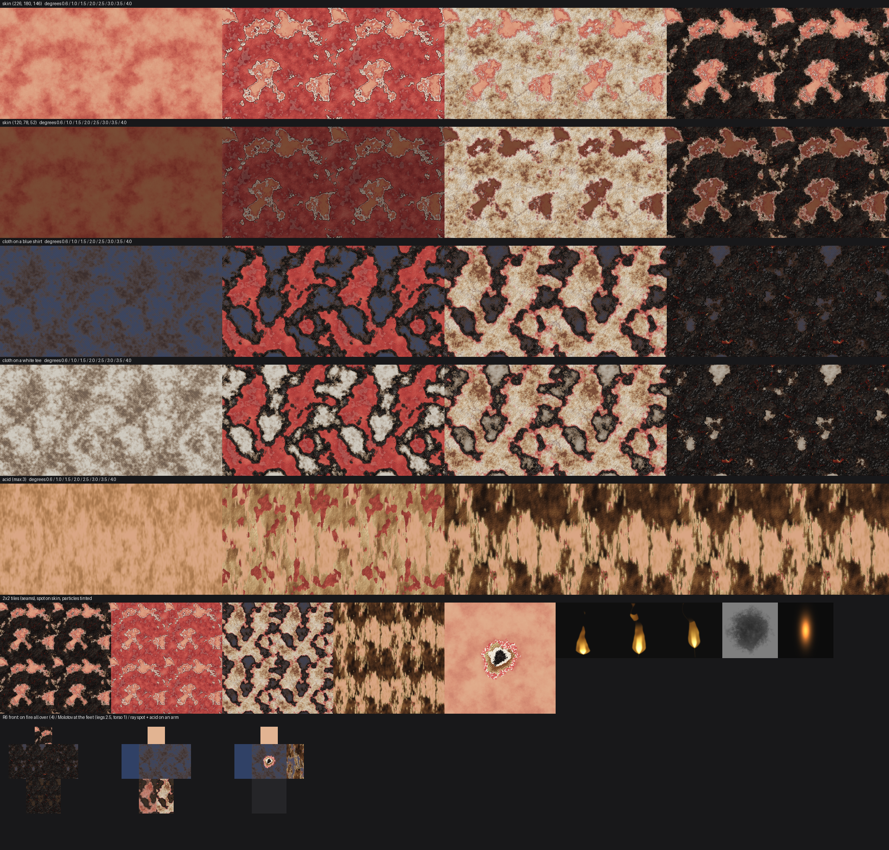

# Brûlures (toutes les sources de feu et d'acide)

Un seul système de brûlures pour tout le jeu : le **rayon** du Dr. Rift (son pistolet laser), son **acide** (fioles, flaques), sa **fiole explosive**, le **feu du Pyromane** (Zippo, Molotov, souffle, poings en feu, Immolation), et tout ce qui brûlera plus tard. La vision thermique du Sentinel ne change pas (ses trous brûlés dans la peau).

## Ce qu'on voit

**La brûlure progresse par degrés** avec le temps passé dans le feu, **sur les membres vraiment touchés** :

| Degré | Peau nue | Sur un T-shirt / pantalon |
|---|---|---|
| 1 | **Rougeur** (érythème) : rouge diffus, marbré | Tissu **roussi** brun-jaune |
| 2 | **Peau partie** : derme rouge à vif, mouillé et luisant ; **peau morte gris-blanc qui pèle** et s'enroule au bord ; quelques **cloques** jaunâtres | Tissu **carbonisé**, **trous brûlés** à travers (peau rouge dedans) |
| 3 | **Escarre** : peau morte sèche, cireuse blanc-gris à beige cuir, brun acajou par endroits, **veines coagulées** sombres visibles, fines fissures | Grands trous, escarre beige dedans |
| 4 | **Carbonisé** : noir mat, plaques de cendre, **fissures** qui montrent la chair rouge sombre et un peu de graisse jaune ; suie brune autour | Le tissu fondu dans la peau carbonisée |

- **Acide** (3 degrés) : tache **jaune-brun** chimique, puis **peau rongée** (débris jaune-brun terne, chair à vif là où elle est partie, bords rongés et pâles), puis **escarre brun-noir** cuir ; tout **coule vers le bas**.
- **Rayon / laser** : une **tache profonde** où il entre (cratère carbonisé, anneau blanc de peau cuite, escarre, peau rouge pelée autour), peu de brûlure autour, des flammes qui s'étendent à peine.
- **Le feu se propage** d'un membre à l'autre : vers le **haut** surtout (les flammes montent), un peu sur les côtés, rarement vers le bas. Debout dans un feu (flaque, Molotov) : les **pieds et le bas des jambes** d'abord.
- **Sur un corps en feu** : des **flammes** (vraies langues de feu, pas de boules), une **fumée noire** épaisse qui monte, des **braises**, une **lumière orange** qui vacille (avec ombres). Acide : ça mousse, une vapeur pâle, des gouttes tombent.
- **Le feu s'éteint proprement** : les flammes partent, le corps **fume** encore (fumée grise, quelques braises sur les parties carbonisées) puis plus rien. Les brûlures **restent** jusqu'au kill (la vie remonte), la nouvelle manche ou la réapparition.
- Un corps qui **meurt en brûlant** brûle encore ~4 s ; sa copie de cadavre aussi (~8 s), puis fume.
- Un membre qui a une **plaie ouverte** (coupure au verre, trou du Sentinel) est remplacé par sa copie percée : ses flammes et sa fumée restent, mais ses images de brûlure ne s'affichent pas dessus tant que la plaie est là.
- Une **tête qui éclate** ou un membre qui s'ouvre **après coup** (brûlure déjà finie, cadavre compris) : ses images de brûlure disparaissent aussitôt (plus de « boîte » brûlée qui flotte).
- **Debout dans une flaque d'acide ou un feu au sol** : la brûlure dépend du **temps passé dedans** (une première marque au contact, puis elle s'approfondit seconde après seconde : il faut plusieurs secondes pour arriver à l'escarre, pas une).
- L'acide **coule** : d'une tête vers le torse, du torse vers la jambe du côté touché (les deux si c'est au milieu).
- **Dégâts** : côté serveur, toutes les 0,5 s pendant la durée de la brûlure (comme avant ; rien n'a changé pour l'équilibrage).
- **Tout le monde voit la même chose** : tout passe par des attributs sur le personnage (`Burn_T`, `Burn_RA`... + `BurnLit` + `BurnSmoke`), donc un joueur qui arrive plus tard, un corps vu de loin puis de près, et les **cadavres** ont les mêmes brûlures.

## Importer les images (une seule fois)

Tant qu'elles ne sont pas importées, **tout marche quand même** : les anciennes images de brûlure (`assets/burns/legacy`, déjà importées) servent de remplacement, et les flammes / fumée / braises utilisent les particules de Roblox. La tache du laser n'apparaît qu'avec `spot.png`.

Les images de `assets/burns/` (pas `preview.png`, c'est l'aperçu ; pas le dossier `legacy`) :

| Fichier | Rôle | Où coller l'ID dans `Config.Injuries.BURNS` |
|---|---|---|
| `skin_1.png` … `skin_4.png` | peau nue, degrés 1 à 4 (se répètent) | `skin = { id1, id2, id3, id4 }` |
| `cloth_1.png` … `cloth_4.png` | sur un vêtement, degrés 1 à 4 | `cloth = { id1, id2, id3, id4 }` |
| `acid_1.png` … `acid_3.png` | acide, degrés 1 à 3 | `acid = { id1, id2, id3 }` |
| `spot.png` | la tache du rayon / laser | `spot = id` |
| `flame.png` | flamme animée (4 × 4 images) | `flame = id` |
| `smoke.png` | bouffée de fumée | `smoke = id` |
| `ember.png` | braise | `ember = id` |

1. Dans Studio : **Asset Manager** (*View* → *Asset Manager*) → **Bulk Import** → choisir les 15 images.
2. Pour chacune : clic droit → **Copy Asset ID** (l'ID de l'**image**, pas du décalque — même méthode que dans `docs/RAIN_FR.md`).
3. Les coller dans `src/shared/Config.luau`, section `Injuries.BURNS` :

```lua
BURNS = table.freeze({
	skin = table.freeze({ 111, 222, 333, 444 }),
	cloth = table.freeze({ 111, 222, 333, 444 }),
	acid = table.freeze({ 111, 222, 333 }),
	spot = 111,
	flame = 111,
	smoke = 111,
	ember = 111,
}),
```

Les anciennes `BURN_IMAGES` peuvent rester : elles ne servent plus dès que les nouvelles sont là.

## Refaire les images

Tout est généré (aucune photo) : `venv/bin/python -I tools/burns/make_burns.py assets/burns`, puis l'aperçu `venv/bin/python -I tools/burns/preview_burns.py` (écrit `assets/burns/preview.png`).



## Pour les autres sources de brûlure (code)

- Un coup : `burn = { kind = "Fire" | "Acid", perSecond, duration, spot = true?, dose = 1?, where = "Legs"? }` dans le `HitDef` (`spot` = un laser : tache profonde, peu de propagation ; `dose` = profondeur d'un coup ; `where` = la partie brûlée si ce n'est pas celle du coup).
- Un sol qui brûle (flaque, Molotov) : le `burn` des `Moves` (pieds d'abord).
- Mettre quelqu'un en feu d'un coup (finisher) : l'attribut `"Burning" = "Fire"` sur le combattant (tout le corps prend feu, même s'il brûlait déjà à l'acide) ; `nil` l'éteint. **S'il brûlait déjà au feu**, l'attribut ne change pas (`"Fire"` → `"Fire"`) et rien ne se passe : appeler aussi `Burns.engulf(cible, "Fire")` côté serveur.
- Côté serveur directement : `Combat/Burns` (`expose`, `ignite`, `engulf`, `burnOn`, `extinguish`, `clear`).

## Le Pyromane

Tout son feu passe par ce système (plus aucune flamme ni fumée « à lui » sur les corps, sauf ses propres avant-bras en Awakening) :

| Coup | Où ça brûle | Profondeur d'un coup |
|---|---|---|
| **Zippo Flare** | le **visage** (face tournée vers lui) | ~1 degré, puis le feu continue |
| **Molotov** sur quelqu'un | la partie touchée par la bouteille | ~1,4 degré |
| Éclaboussure du Molotov | les **jambes** (côté de l'éclatement) | ~0,8 |
| **Flaque de feu** | les **pieds et le bas des jambes** d'abord, selon le temps passé dedans | (au temps) |
| **Fire Breath** / **Inferno Breath** | le **torse** (face vers sa bouche), un peu à chaque coup du jet | ~0,35 / ~0,3 par coup (4-5 coups) |
| **Burning Fist** / **Burning Rush** | là où le poing frappe | ~0,7 |
| **Immolation** | **tout le corps** prend feu d'un coup | 0,5 partout, puis ça s'aggrave ~12 s : carbonisé |

- **Trempé d'essence** (Douse, Molotov, Immolation) : le premier feu qui le touche **embrase tout le corps** (en plus de ×1,5 dégâts et +2 s).
- Les **vêtements** se carbonisent par la série « tissu » (roussi, trous, fondu dans la peau) : plus de teinte noire posée sur le T-shirt.
- **Immolation** : le corps mort brûle encore `PyroConfig.IMMOLATE_BURN` (12 s, sa copie de cadavre aussi), puis **fume** (fumée grise ~18 s). `PyroFx` ne garde que le son du corps qui brûle.
- Réglages par coup : `dose` (profondeur d'un coup, 1 par défaut) et `where` (la partie brûlée si ce n'est pas celle du coup) dans le `burn` du `HitDef` (`Shared/Kits/Pyromaniac.luau`).
