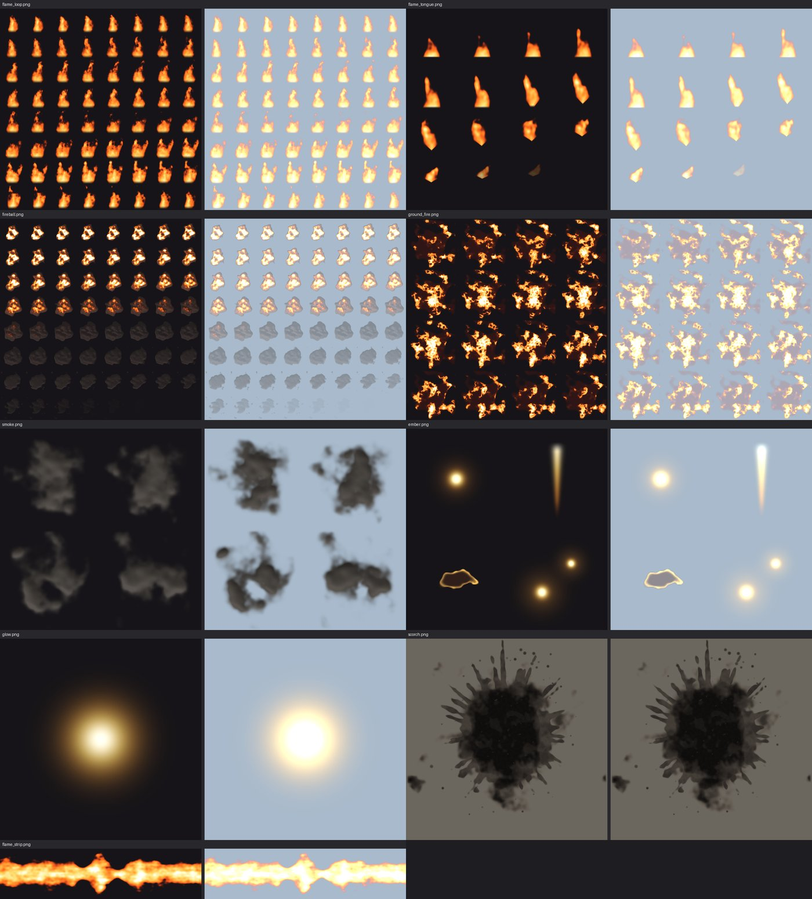
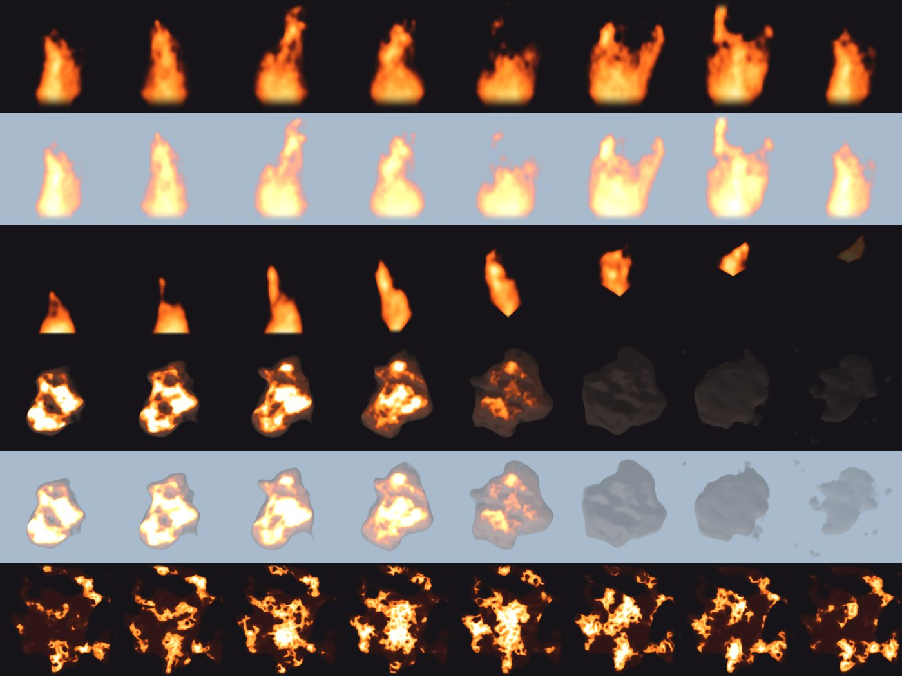
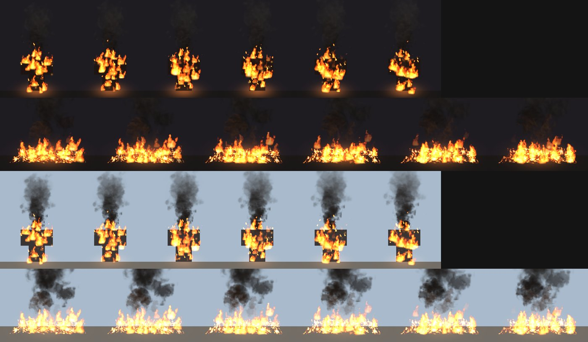

# Le feu (corps qui brûlent, Pyromane)

Toutes les flammes du jeu passent par un seul module, `src/client/Combat/FireLook.luau` : les corps en feu (`Burns`, toutes les sources), et tout le Pyromane (`PyroFx` : les jets de son lance-flammes, les boules de napalm, les flaques, les bras en feu, l'Immolation).

## Ce qui a changé

Avant, une flamme = une tache orange floue de Roblox (`fire_main`) qui monte. Maintenant chaque feu est fait de **couches**, comme dans les jeux pros :

| Couche | Ce que c'est |
|---|---|
| **Corps** (`flame_loop.png`) | quelques **gros paquets de flammes** animés en boucle (3 à 5 langues qui se rejoignent) : la masse du feu |
| **Langues** (`flame_tongue.png`) | des langues qui **lèchent vers le haut**, s'étirent, se détachent et se déchirent |
| **Cœur** (`glow.png`) | la lueur très chaude collée au membre / au combustible |
| **Fumée** (`smoke.png`) | 4 bouffées différentes, **chaude en bas** (éclairée par le feu), noire de suie, puis grise |
| **Braises** (`ember.png`) | point, traînée, flocon qui brûle, double étincelle |
| **Boule de feu** (`fireball.png`) | pleine taille **dès la 1re image**, roule vers le haut, devient de la suie |
| **Feu au sol** (`ground_fire.png`) | un film d'essence en feu **à plat sur le sol**, bords irréguliers (jamais un rond) |
| **Ruban** (`flame_strip.png`) | le cœur continu des jets du lance-flammes (Beam, depuis le canon) et la traînée des boules de napalm (Trail) |
| **Brûlé** (`scorch.png`) | la marque noire au sol : bord cassé, doigts d'éclaboussure, gouttes |

- **Corps en feu** : par membre, corps + langues + cœur + braises ; **une seule** colonne de fumée et **une seule** lumière par corps, placées au milieu de ce qui brûle et qui bougent un peu (les ombres « rampent »). Le feu **respire** (flammes et lumière ensemble), a des **flambées** de temps en temps, **prend** en une fraction de seconde (une gerbe de langues, la lumière saute) et **s'éteint en ~1 s** (dernière bouffée de fumée), plus jamais d'un coup.
- **Flaques** : chaque cellule a son film au sol + ses flammes debout (hauteurs différentes) ; une cellule **prend** avec une gerbe, **baisse** sur sa dernière seconde. Une lumière par flaque, au-dessus des flammes qui restent ; **ombres** seulement pour la flaque la plus proche. La marque noire **se forme pendant que ça brûle** : une grande marque irrégulière + quelques taches plus petites (plus de disques par cellule).
- **Pyromane** : **tous ses jets sortent du canon de son lance-flammes**, chacun avec sa forme : FLASH BURST une **boule de feu** qui éclate pleine taille d'un coup ; NAPALM LOB une **boule de napalm** qui tremble en vol (ruban de flamme, gouttes en feu) et s'écrase **sans verre** ; FLAME STREAM un **jet continu** qui sort en 0,09 s, freine, monte en boule au bout, la lumière **dans** le jet, et **se détache du canon** à la fin ; FUEL SPRAY un éventail d'**essence crue sans flamme** ; en Awakening une **racine bleu-blanc** sur chaque jet (lance du BLOWTORCH, colonne de l'activation, INFERNO qui **lèche et allume le sol**, vague de feu de TORCH CHARGE), le manchon qui **luit orange** à travers ses trous ; les coups au corps ont un **impact** (flamme, étincelles, flash) ; l'Immolation a l'**essence crue versée** du canon, les **éclaboussures** sur la tête, une **tache d'essence** sous le corps, le **plein jet à bout portant** avec le canon **rouge cerise**, puis le **sol qui prend feu** autour du corps. Le bleu n'apparaît qu'à deux endroits : la **veilleuse** (propane) et la racine des jets en Awakening / finisher ; le reste est de l'essence : jaune-orange, pointe noire de suie.
- **Performances** : moins de particules mais plus grandes (~17 flammes par membre en feu au lieu de ~40 petites, une fumée par corps au lieu de six). La **qualité graphique Roblox** compte : 1-3 = moitié moins de particules et pas de cœur ; 4-6 et automatique = trois quarts ; téléphone = trois quarts au plus.

## Importer les images (une seule fois)

**Tout marche sans elles** : en attendant, les anciennes images des brûlures (`flame.png`, `smoke.png`, `ember.png` de `assets/burns`) ou les particules de Roblox les remplacent, le ruban des jets / des boules de napalm n'apparaît pas (les jets restent des paquets de flammes et un trait de lumière), et la marque au sol est faite de quelques ellipses sombres.

Les 9 images de `assets/fire/` :

| Fichier | Où coller l'ID dans `Config.Injuries.FIRE` |
|---|---|
| `flame_loop.png` | `flameLoop` |
| `flame_tongue.png` | `flameTongue` |
| `fireball.png` | `fireball` |
| `ground_fire.png` | `groundFire` |
| `smoke.png` | `smoke` |
| `ember.png` | `ember` |
| `glow.png` | `glow` |
| `flame_strip.png` | `flameStrip` |
| `scorch.png` | `scorch` |

1. Dans Studio : **Asset Manager** (*View* → *Asset Manager*) → **Bulk Import** → choisir les 9 images (pas les aperçus de `docs/fire`).
2. Pour chacune : clic droit → **Copy Asset ID** (l'ID de l'**image**, pas du décalque — même méthode que `docs/BURNS_FR.md`).
3. Les coller dans `src/shared/Config.luau`, section `Injuries.FIRE` :

```lua
FIRE = table.freeze({
	flameLoop = 111,
	flameTongue = 111,
	fireball = 111,
	groundFire = 111,
	smoke = 111,
	ember = 111,
	glow = 111,
	flameStrip = 111,
	scorch = 111,
}),
```

Les grandes feuilles d'animation font 1024 × 1024 (la taille max de Roblox) : ne pas les redimensionner. Si Roblox réduit la qualité à l'import, réimporter sans compression.

## Refaire les images

Tout est généré (aucune photo) :

- `venv/bin/python -I tools/pyro/make_fire.py assets/fire` (toutes) ou `... assets/fire flame_loop fireball` (seulement celles-là) ;
- `venv/bin/python -I tools/pyro/preview_fire.py assets/fire <dossier>` écrit `sheets.png` (chaque feuille sur nuit / ciel), `frames.png` (des images en grand) et `scene.png` (une petite simulation des couches : un corps R6 en feu, une flaque, nuit et jour).




