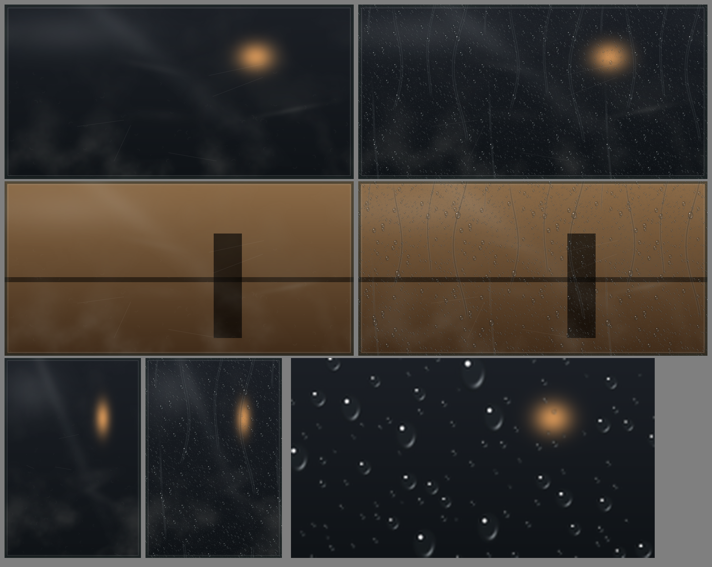

# Vitres réalistes (verre de la ville)

Toutes les vitres de Marrow District sont maintenant en **vrai verre**, d'après la vidéo de référence « realistic glass » (`docs/references/video14.md`). Dans la vidéo, ce qui fait « verre », c'est une face **claire** avec un léger **reflet miroir**, des **bords plus sombres** (l'épaisseur du verre), **un seul petit reflet** de lumière et une ombre **pâle** (la lumière traverse). C'est ce qu'on reproduit.

## Ce qui change

| Vitres | Avant | Maintenant |
|---|---|---|
| **Vitrines** des boutiques, **portes vitrées**, impostes au-dessus des portes, **cabine téléphonique**, verrière du toit B2 | plastique gris foncé à moitié transparent | matériau **Glass** de Roblox, vert-gris très clair (verre à vitre), transparence 0,62, reflet 0,18, **pas d'ombre**. On voit la pièce sombre derrière, avec un reflet de la rue par-dessus. |
| **Fenêtres des étages**, bandeaux de la tour Marrow, hall de la tour, guichets, impostes éclairées | plastique foncé | verre **opaque et sombre** qui reflète le ciel (reflet 0,32). Un mur est juste derrière, on ne peut donc pas voir à travers ; chaque vitre a une teinte un peu différente (le vieux verre n'est jamais pareil). |
| Fenêtres **éclairées la nuit** | inchangées | toujours allumées la nuit comme avant ; quand elles s'éteignent, elles redeviennent en verre. |
| Fenêtres **condamnées** (planches), bouteilles du bar, vitres des voitures, immeubles du fond | — | **pas touchées**. |

**Saleté** (près de toi) : un film de poussière très léger, plus marqué en bas, quelques traces d'eau séchée, de fines rayures, un bord un peu plus sombre et un léger reflet en haut à gauche.

**Pluie sur les vitres** (pendant l'événement *Rain* / *Thunderstorm*) :

- les vitres **exposées au ciel** près de toi se **mouillent petit à petit** (environ 20 s) : des **gouttes** apparaissent (bord sombre, corps transparent, petit reflet blanc en haut à gauche, comme dans la vidéo des gouttelettes) ;
- des gouttes **coulent lentement vers le bas** en laissant une traînée mouillée (plus vite pendant l'orage) ;
- quand la pluie s'arrête, l'eau arrête de couler, puis la vitre **sèche** en environ 25 s ;
- une vitre sous un **auvent** ou un toit reste **sèche** ;
- sur les vitrines, les gouttes se voient **aussi depuis l'intérieur**.

**Vitres cassées** : une vitrine (ou une porte vitrée) cassée par un coup lourd éclate en **éclats de verre fins** (triangles transparents, épaisseur du vrai verre, sans ombre), avec un éclat de lumière froide d'une image, des **paillettes** qui tombent et le **bruit de verre brisé**. Les éclats **restent au sol** 16 à 22 s. La vitre revient comme avant (25 s après, comme les murs).

## Qualité graphique (optimisation)

| Réglage *Graphics quality* | Vitrines | Saleté | Vitres avec pluie |
|---|---|---|---|
| 1 à 3 (bas) | plastique transparent (le verre Roblox disparaît presque à ce niveau) | non | les 8 plus proches (30 studs), gouttes immobiles |
| 4 à 7, ou **Automatique**, ou téléphone/tablette | verre | jusqu'à 90 studs | les 18 plus proches (50 studs) |
| 8 à 10 (PC) | verre | jusqu'à 160 studs | les 32 plus proches (70 studs) |

Aucune pièce n'est ajoutée à la map (elle est presque à sa limite de 7000) : seulement des images posées sur les vitres existantes, créées **sur ton écran seulement** et seulement près de toi.

**Depuis l'intérieur** (bar, boutiques, pièce derrière un mur cassé) les vitrines passent en plastique transparent : en qualité haute, Roblox **n'affiche pas** la pluie, les faisceaux ni les enseignes derrière du verre « Glass », la rue aurait l'air sèche et noire. Dehors, c'est du vrai verre.

## Importer les images (une seule fois)

Tant qu'elles ne sont pas importées, **les vitres sont quand même en verre** ; seules la saleté et la pluie sur les vitres ne s'affichent pas.

Les 4 images de `assets/glass/` (pas `preview.png`, c'est juste l'aperçu) :

| Fichier | Taille | Rôle | Où coller l'ID dans `Config.Glass.IMAGES` |
|---|---|---|---|
| `glass_dirt_wide.png` | 1024 × 512 | saleté + bord, vitres larges (vitrines, impostes) | `dirtWide` |
| `glass_dirt_tall.png` | 512 × 768 | saleté + bord, vitres hautes (fenêtres, portes, cabine) | `dirtTall` |
| `glass_rain_beads.png` | 512 × 512 | gouttes posées sur la vitre (se répète) | `rainBeads` |
| `glass_rain_runs.png` | 256 × 1024 | gouttes qui coulent + traînées (se répète, défile vers le bas) | `rainRuns` |

1. Dans Studio : **Asset Manager** (*View* → *Asset Manager*) → **Bulk Import** → choisir les 4 images.
2. Pour chacune : clic droit → **Copy Asset ID** (l'ID de l'**image**, pas du décalque — même méthode que dans `docs/RAIN_FR.md`).
3. Les coller dans `src/shared/Config.luau`, section `Glass` :

```lua
IMAGES = table.freeze({
	dirtWide = 123456789,
	dirtTall = 123456789,
	rainBeads = 123456789,
	rainRuns = 123456789,
}),
```

Pour refaire les images : `python3 -I tools/glass/make_glass_textures.py` (depuis la racine du repo ; il faut `numpy` et `pillow`).



## Réglages (`Config.Glass`)

- `CLEAR_TRANSPARENCY` / `CLEAR_REFLECTANCE` / `CLEAR_COLOR` : les vitrines. Plus de transparence = on voit mieux l'intérieur, moins de reflet.
- `DARK_REFLECTANCE` : le reflet des fenêtres des étages.
- `DIRT_TRANSPARENCY` : 1 = pas de saleté du tout.
- `RUN_SPEED` : vitesse des gouttes qui coulent. **Si les gouttes remontent la vitre au lieu de descendre**, mets `RUN_DIRECTION = -1`.
- `WET_TIME` / `DRY_TIME` : temps pour se mouiller / sécher.
- `RAIN_PANES`, `RAIN_RANGE`, `DIRT_RANGE` : combien de vitres et à quelle distance, par niveau de qualité.

## Limites

- Roblox ne fait pas de vraie réfraction : le verre « Glass » déforme un peu l'arrière-plan **seulement en qualité haute** et sur PC ; ailleurs c'est un verre teinté avec reflet.
- Le mode **Automatique** ne peut pas être lu par un jeu : il compte comme qualité moyenne.
- Les gouttes qui coulent défilent avec leur traînée (une image qui glisse), ce n'est pas une simulation goutte par goutte.
