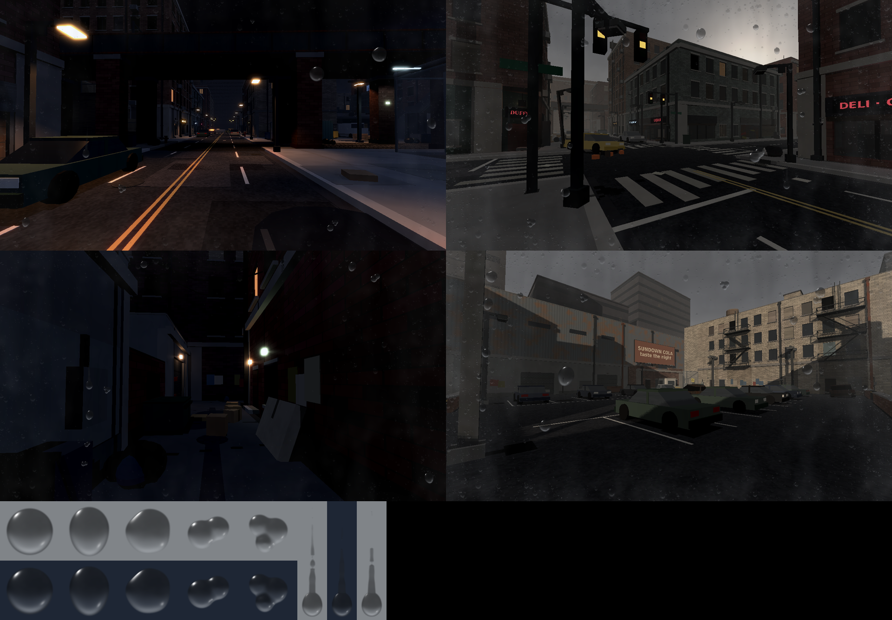

# Pluie sur l'écran (gouttes réalistes)

Quand tu es dehors sous la pluie, un peu d'eau se dépose sur « l'objectif » de la caméra, comme sur une vraie caméra :

- de temps en temps une **goutte tombe** sur l'écran (sur les côtés ou en haut, presque jamais au centre) ;
- la plupart **restent immobiles** et **grossissent** doucement ; deux gouttes qui se touchent **fusionnent** en une plus grosse ;
- quand une goutte devient assez lourde, elle **coule vers le bas** (lentement puis de plus en plus vite, en zigzaguant un peu), avec une petite **traînée mouillée** au-dessus, et sort de l'écran ;
- sous une forte pluie, une **buée de minuscules gouttelettes** et un léger voile humide apparaissent sur les **bords** ;
- sous un toit, un auvent, dans le bar ou une boutique : tout **sèche en quelques secondes** ; dans le parc ou en duel : tout **disparaît d'un coup**.

Roblox ne sait pas déformer l'image derrière une interface (pas de vraie réfraction). Chaque goutte est donc une **image** d'une vraie goutte d'eau sur du verre (on y voit une minuscule image floue et à l'envers de la rue : sombre en haut, ciel pâle en bas ; bord sombre plus épais en bas et sur les côtés ; un petit reflet net en haut à gauche ; des bords un peu flous, comme sur l'objectif d'une caméra). Ces images sont dans `assets/raindrops/` et il faut les **importer une fois** dans Roblox.

**Tant que les images ne sont pas importées, rien ne s'affiche sur l'écran** (le reste de la pluie marche normalement).



## Importer les images (une seule fois)

Les 11 images de `assets/raindrops/` (pas `preview.png`, c'est juste l'aperçu) :

| Fichier | Taille | Rôle | Où coller l'ID dans `Config.Weather.SCREEN_RAIN_IMAGES` |
|---|---|---|---|
| `drop_round.png` | 256 × 256 | goutte ronde | `drops`, 1ᵉʳ nombre |
| `drop_egg.png` | 256 × 256 | goutte en œuf (plus lourde en bas) | `drops`, 2ᵉ nombre |
| `drop_irregular.png` | 256 × 256 | goutte irrégulière | `drops`, 3ᵉ nombre |
| `drop_merged_2.png` | 256 × 256 | deux gouttes fusionnées | `merged`, 1ᵉʳ nombre |
| `drop_merged_3.png` | 256 × 256 | trois gouttes fusionnées | `merged`, 2ᵉ nombre |
| `streak_1.png` … `streak_3.png` | 128 × 512 | goutte qui coule + sa traînée | `streaks`, dans l'ordre |
| `mist_1.png`, `mist_2.png` | 1024 × 512 | buée fine sur les bords | `mist`, dans l'ordre |
| `wet_glass.png` | 512 × 256 | léger voile humide sur les bords | `wet` |

1. Dans Studio : **Asset Manager** (onglet *View* → *Asset Manager*) → bouton **Bulk Import** → choisir les 11 images. (Ou sur le web : **Creator Dashboard** → *Development Items* → *Decals* → *Upload Asset*, une image à la fois.)
2. Pour chacune, copier son **ID d'image** : dans l'Asset Manager, clic droit sur l'image → **Copy Asset ID**. Attention : il faut l'ID de l'**image**, pas celui du décalque. (Sur le web, un décalque a deux IDs : si l'image ne s'affiche pas, colle l'ID du décalque dans la propriété *Texture* d'un `Decal` dans Studio : Studio le remplace par l'ID de l'image, c'est celui-là qu'il faut.)
3. Les coller dans `src/shared/Config.luau`, section `Weather`, `SCREEN_RAIN_IMAGES` :

```lua
SCREEN_RAIN_IMAGES = table.freeze({
	drops = table.freeze({ id_round, id_egg, id_irregular }),
	merged = table.freeze({ id_merged_2, id_merged_3 }),
	streaks = table.freeze({ id_streak_1, id_streak_2, id_streak_3 }),
	mist = table.freeze({ id_mist_1, id_mist_2 }),
	wet = id_wet_glass,
}),
```

4. Rojo synchronise, lance le jeu, puis `workspace:SetAttribute("WeatherForce", "Rain")` (barre de commande, côté serveur).

Notes :

- `0` = pas importée. Seules les gouttes (`drops`) sont obligatoires : sans `merged`, une goutte fusionnée garde son image ; sans `streaks`, les gouttes coulent sans traînée ; sans `mist` / `wet`, pas de buée.
- **Ne redimensionne pas** les `streak_*.png` (128 × 512) : le jeu n'affiche que le bas de l'image (la traînée s'allonge quand la goutte coule) et compte en pixels de l'image.
- Pour refaire les images (autres formes, plus de variantes) : `python3 tools/raindrops/make_raindrop_textures.py` depuis la racine du dépôt, puis l'aperçu : `python3 tools/raindrops/preview.py sortie.png capture1.png capture2.png …`.
- Les réglages (combien de gouttes, leur taille, la vitesse à laquelle elles coulent ou sèchent) sont en haut de `src/client/UI/LensRain.luau`.
