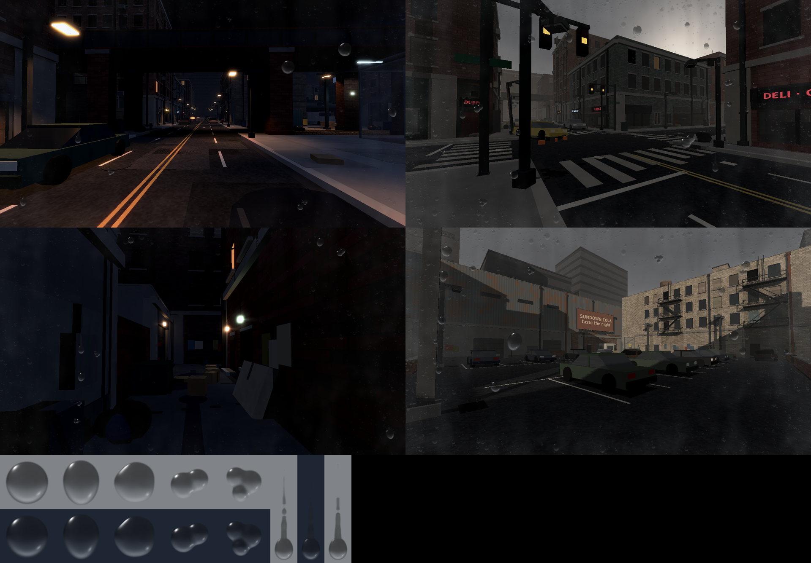
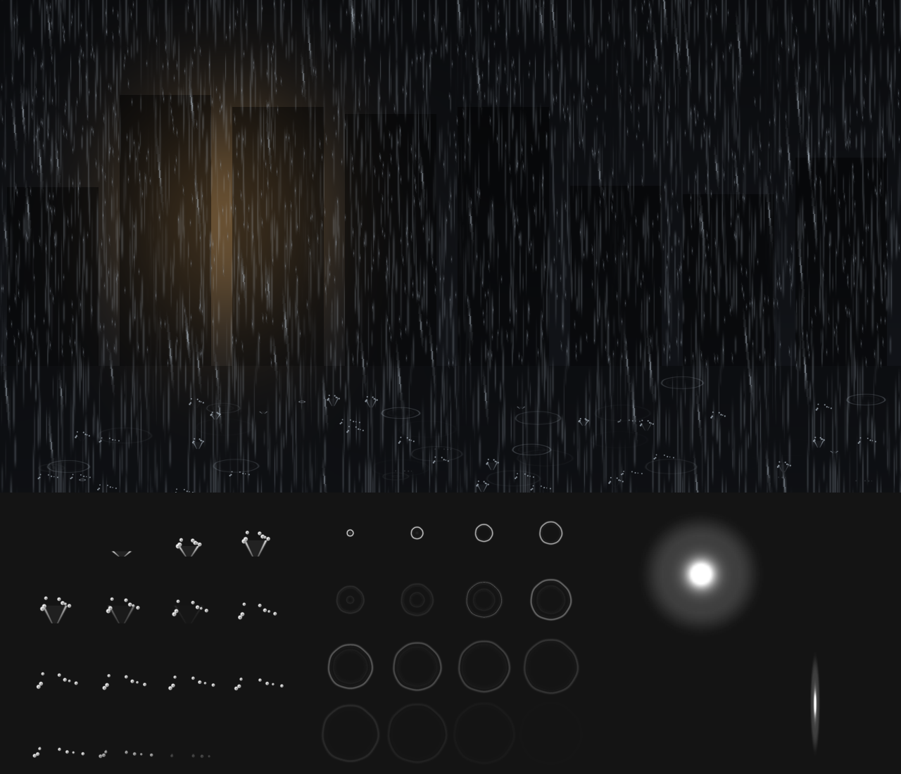

# Pluie sur l'écran (gouttes réalistes)

Quand tu es dehors sous la pluie, un peu d'eau se dépose sur « l'objectif » de la caméra, comme sur une vraie caméra :

- de temps en temps une **goutte tombe** sur l'écran (sur les côtés ou en haut, presque jamais au centre) ;
- la plupart **restent immobiles** et **grossissent** doucement ; deux gouttes qui se touchent **fusionnent** en une plus grosse ;
- quand une goutte devient assez lourde, elle **coule vers le bas** (lentement puis de plus en plus vite, en zigzaguant un peu), avec une petite **traînée mouillée** au-dessus, et sort de l'écran ;
- sous une forte pluie, une **buée de minuscules gouttelettes** et un léger voile humide apparaissent sur les **bords** ;
- sous un toit, un auvent, dans le bar ou une boutique : tout **sèche en quelques secondes** ; dans le parc ou en duel : tout **disparaît d'un coup**.

Roblox ne sait pas déformer l'image derrière une interface (pas de vraie réfraction). Chaque goutte est donc une **image** d'une vraie goutte d'eau sur du verre (on y voit une minuscule image floue et à l'envers de la rue : sombre en haut, ciel pâle en bas ; bord sombre plus épais en bas et sur les côtés ; un petit reflet net en haut à gauche ; des bords un peu flous, comme sur l'objectif d'une caméra). Ces images sont dans `assets/raindrops/` et il faut les **importer une fois** dans Roblox.

**Tant que les images ne sont pas importées, rien ne s'affiche sur l'écran** (le reste de la pluie marche normalement).



## Importer les images (une seule fois)

Les 11 images de `assets/raindrops/` (pas `preview.png`, c'est juste l'aperçu) :

| Fichier | Taille | Rôle | Où coller l'ID dans `Config.Weather.SCREEN_RAIN_IMAGES` |
|---|---|---|---|
| `drop_round.png` | 256 × 256 | goutte ronde | `drops`, 1ᵉʳ nombre |
| `drop_egg.png` | 256 × 256 | goutte en œuf (plus lourde en bas) | `drops`, 2ᵉ nombre |
| `drop_irregular.png` | 256 × 256 | goutte irrégulière | `drops`, 3ᵉ nombre |
| `drop_merged_2.png` | 256 × 256 | deux gouttes fusionnées | `merged`, 1ᵉʳ nombre |
| `drop_merged_3.png` | 256 × 256 | trois gouttes fusionnées | `merged`, 2ᵉ nombre |
| `streak_1.png` … `streak_3.png` | 128 × 512 | goutte qui coule + sa traînée | `streaks`, dans l'ordre |
| `mist_1.png`, `mist_2.png` | 1024 × 512 | buée fine sur les bords | `mist`, dans l'ordre |
| `wet_glass.png` | 512 × 256 | léger voile humide sur les bords | `wet` |

1. Dans Studio : **Asset Manager** (onglet *View* → *Asset Manager*) → bouton **Bulk Import** → choisir les 11 images. (Ou sur le web : **Creator Dashboard** → *Development Items* → *Decals* → *Upload Asset*, une image à la fois.)
2. Pour chacune, copier son **ID d'image** : dans l'Asset Manager, clic droit sur l'image → **Copy Asset ID**. Attention : il faut l'ID de l'**image**, pas celui du décalque. (Sur le web, un décalque a deux IDs : si l'image ne s'affiche pas, colle l'ID du décalque dans la propriété *Texture* d'un `Decal` dans Studio : Studio le remplace par l'ID de l'image, c'est celui-là qu'il faut.)
3. Les coller dans `src/shared/Config.luau`, section `Weather`, `SCREEN_RAIN_IMAGES` :

```lua
SCREEN_RAIN_IMAGES = table.freeze({
	drops = table.freeze({ id_round, id_egg, id_irregular }),
	merged = table.freeze({ id_merged_2, id_merged_3 }),
	streaks = table.freeze({ id_streak_1, id_streak_2, id_streak_3 }),
	mist = table.freeze({ id_mist_1, id_mist_2 }),
	wet = id_wet_glass,
}),
```

4. Rojo synchronise, lance le jeu, puis `workspace:SetAttribute("WeatherForce", "Rain")` (barre de commande, côté serveur).

Notes :

- `0` = pas importée. Seules les gouttes (`drops`) sont obligatoires : sans `merged`, une goutte fusionnée garde son image ; sans `streaks`, les gouttes coulent sans traînée ; sans `mist` / `wet`, pas de buée.
- **Ne redimensionne pas** les `streak_*.png` (128 × 512) : le jeu n'affiche que le bas de l'image (la traînée s'allonge quand la goutte coule) et compte en pixels de l'image.
- Pour refaire les images (autres formes, plus de variantes) : `python3 tools/raindrops/make_raindrop_textures.py` depuis la racine du dépôt, puis l'aperçu : `python3 tools/raindrops/preview.py sortie.png capture1.png capture2.png …`.
- Les réglages (combien de gouttes, leur taille, la vitesse à laquelle elles coulent ou sèchent) sont en haut de `src/client/UI/LensRain.luau`.

# Pluie dans la ville (la vraie pluie qui tombe)

Pendant l'événement météo **Rain** (et l'orage, sa version forte), la pluie tombe **partout autour de toi** dans la ville, en trois profondeurs, pour que ça ne ressemble jamais à un filtre collé sur l'écran :

- **près de toi** (≈ 20 studs) : peu de gouttes, mais de longs traits nets qui tombent vite (une goutte d'eau claire avec un reflet brillant, étirée par sa vitesse comme sur une vraie caméra) ;
- **plus loin** (jusqu'à ≈ 100 studs) : des traits plus fins, plus serrés, plus pâles ;
- **au fond** (≈ 150 studs) : des « rideaux » de pluie grise + la brume que le serveur ajoute au ciel : la ville lointaine devient voilée.

Les gouttes tombent à ≈ 150 studs/s, un peu penchées par le vent (beaucoup en orage, plus fort pendant une rafale). Elles sont posées sur une **grille fixe dans le monde** : quand tu marches, tu traverses la pluie, elle ne te suit pas.

**Pas de pluie dedans** : le jeu connaît la hauteur du premier toit sous chaque morceau de ciel (quelques rayons vers le bas, gardés en mémoire) ; les gouttes s'arrêtent sur les toits, les auvents, le viaduc. Près de toi il prend le toit le plus haut (aucune goutte sous un auvent).

Au sol : **petites couronnes d'éclaboussures** sur le sol dur (pas sur l'herbe), **petits cercles** sur le sol mouillé et dans les flaques, et une **brume** très légère au ras du sol. Le son de la pluie devient **sourd** sous un toit et à l'intérieur.

Ça commence et finit **en douceur avec l'événement** (même rampe que le ciel du serveur : ≈ 25 s pour monter, ≈ 30 s pour s'arrêter) et ça s'arrête complètement à la fin. Rien dans le parc (toujours ensoleillé) ni en duel.

**Qualité** (Paramètres Roblox → Qualité graphique) : 1-3 = léger (moins de gouttes au loin, pas de cercles ni de brume, 4 rideaux), 4-7 = moyen, 8-10 = tout. En « Automatique », le jeu commence en moyen et baisse / remonte tout seul selon les FPS. Téléphones et tablettes : moyen au maximum. Au plus ≈ 3 800 gouttes à l'écran en plein orage en qualité max, ≈ 1 300 en qualité basse.



## Importer les images (une seule fois)

**Sans les images, la pluie marche déjà** (textures Roblox intégrées à la place), mais sans les rideaux lointains et avec des éclaboussures plus simples. Les 4 images de `assets/rain/` (pas `preview.png`) :

| Fichier | Taille | Rôle | Où coller l'ID dans `Config.Weather.RAIN_IMAGES` |
|---|---|---|---|
| `rain_drop.png` | 64 × 64 | une goutte (étirée en trait par le jeu) | `drop` |
| `rain_splash.png` | 512 × 512 (4 × 4 images) | l'éclaboussure en couronne | `splash` |
| `rain_ripple.png` | 1024 × 1024 (4 × 4 images) | le cercle sur l'eau (rues mouillées et flaques) | `ripple` |
| `rain_sheet.png` | 1024 × 256 | le rideau de pluie lointain | `sheet` |

Même méthode que plus haut (Asset Manager → Bulk Import → clic droit → Copy Asset ID, l'ID de l'**image**), puis dans `src/shared/Config.luau`, section `Weather` :

```lua
RAIN_IMAGES = table.freeze({
	drop = id_rain_drop,
	splash = id_rain_splash,
	ripple = id_rain_ripple,
	sheet = id_rain_sheet,
}),
```

Notes :

- **Ne redimensionne pas** `rain_splash.png` ni `rain_ripple.png` : ce sont des animations de 16 images en grille 4 × 4.
- Si les rideaux lointains semblent **monter** au lieu de tomber, mets `CURTAIN_SPEED` en négatif dans `Config.Weather.RAIN`.
- Si les traits de pluie paraissent **trop courts / trop larges**, joue sur `NEAR_SIZE` / `MID_SIZE` et `STRETCH` (de `-3` = le plus long, à `0` = une goutte ronde) dans `Config.Weather.RAIN`. La densité : `NEAR_RATE`, `MID_RATE` ; la vitesse : `FALL_SPEED`.
- Pour refaire les images : `python3 tools/rain/make_rain_textures.py` depuis la racine du dépôt, puis l'aperçu : `python3 tools/rain/preview.py`.
- Le code : `src/client/Controllers/RainController.luau` (la pluie, les éclaboussures, les cercles, la brume, les rideaux) ; `WeatherController` donne la force de la pluie et le vent.
