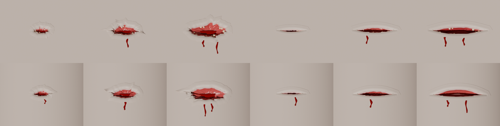
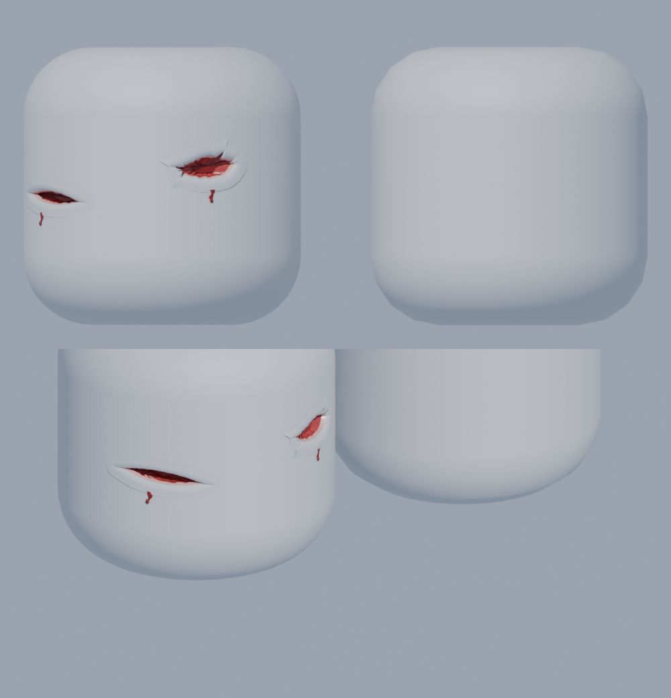
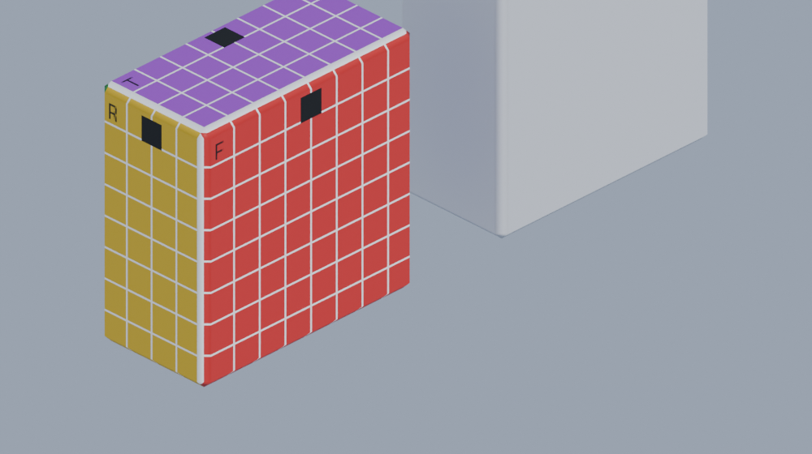
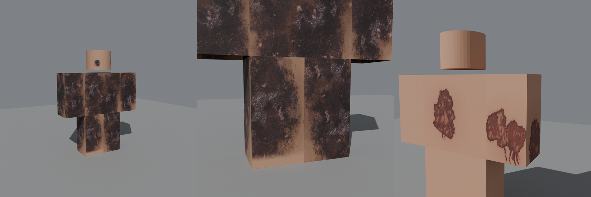

# Coupures réalistes (bouteille en verre)

Une bouteille ne casse pas un crâne et n'ouvre pas une cage thoracique. Le jeu montre donc ce qu'elle fait **vraiment** (sources médico-légales) :

| Coup | Plaie | Ce qu'on voit |
|---|---|---|
| **Bouteille fracassée** (touche 1) | **Lacération** : déchirure irrégulière, souvent en étoile | Bord de peau déchiré, bord rose de la peau coupée, chair rouge, gras jaune (sur le corps), du sang dans la plaie et qui coule |
| **Bouteille cassée** (Broken Bottle) | **Entaille** : longue, bords nets, en fuseau | Pareil, plus long et plus fin. Une entaille profonde (taille L) montre le **muscle** sur le corps, ou tout juste **l'os du crâne** au fond sur la tête (peau fine) |

- Une bouteille fracassée laisse aussi des **bouts de verre plantés** dans la peau. Environ 1 fois sur 3, il n'y a que du verre, sans vraie plaie (`GLASS_GRAZE_CHANCE` dans `Config.luau`).
- Le sang qui coule tombe **de la plaie**.
- Le finisher à la batte du Street Brawler **fait exploser la tête** avec de vraies pièces anatomiques, elles aussi dans `WoundKit` (`Gore_*`) : morceaux de crâne (cuir chevelu dehors, vrai os dedans), cerveau avec ses plis, yeux, dents, et sur le corps la vraie mâchoire du bas avec ses dents, la peau du menton déchirée, les premières vertèbres. Les flaques et éclaboussures au sol sont aussi des formes du kit. Anatomie : **Z-Anatomy** (CC BY-SA 4.0, voir `tools/wounds/anatomy/README.md`). Sans ces pièces (ancien `WoundKit`), le jeu en dessine des plus simples.
- Le finisher du **Boxer** arrache le **vrai foie** (avec la vésicule biliaire), à la main, sous les côtes droites : la plaie `Tear` (`TearL` dans `WoundKit`) est un trou déchiré dans le torse, avec les **vraies côtes 8 à 10 cassées** dedans (Z-Anatomy). Le jeu découpe le torse et le t-shirt autour, comme pour les autres plaies.
- Le finisher du **Videur** (kit Bouncer) **arrache le bras droit** à l'épaule. Le serveur détache le bras (il reste une pièce du corps, donc la manche du t-shirt reste dessus), le soude dans le poing du Videur, puis le lâche quand il le jette. Il pose l'attribut `ArmTorn` sur le corps : chaque client dessine alors les plaies avec les pièces `Gore_Shoulder_*` (la cavité de l'épaule ouverte, la cupule de l'omoplate, le bout de la clavicule, la peau déchirée, des lambeaux de muscle) et `Gore_ArmEnd_*` (le bout du bras à vif, la tête de l'os du bras qui dépasse, des tendons, la peau qui pend). L'os du bras (humérus), l'omoplate (sa cavité, l'acromion), le bout de la clavicule et les **muscles** (deltoïde, biceps, triceps, brachial, coraco-brachial côté bras ; coiffe des rotateurs et grand pectoral côté épaule, arrachés) sont les **vrais os et muscles de Z-Anatomy**, avec une couche de graisse jaune sous la peau (`tools/wounds/extract_arm.py` → `anatomy/arm.npz`, depuis `SkeletalSystem100.fbx` et `MuscularSystem100.fbx` du dépôt Z-Anatomy) ; la chair et la peau autour sont modélisées dans `tools/wounds/gore.py` (fonction `torn_arm`). Sans elles (ancien `WoundKit`), `src/client/Combat/ArmRip.luau` dessine des formes plus simples. L'os entier qu'on peut ramasser et lancer est `Gore_Humerus_*`, et ses deux moitiés quand il se casse `Gore_HumerusA_*` / `Gore_HumerusB_*` (`src/client/Combat/WeaponFx.luau`).
- Les **bleus** (`Bruise_<Partie>_<n>`, `src/shared/Util/Bruise.luau`, dessinés par `src/client/Combat/Wounds.luau`) se placent là où le coup touche, grossissent si on retape au même endroit, gonflent sur le visage et changent de couleur avec le temps (rouge, violet, bleu). Ils ne se voient pas à travers les vêtements.
- Frapper **au même endroit** agrandit la plaie : **S → M → L**. Ailleurs, ça fait une nouvelle plaie (3 au maximum par partie du corps).
- La plaie se trouve **du côté où se tient l'attaquant**, à une hauteur au hasard : front, tempe ou joue pour la tête ; poitrine, ventre ou dos pour le torse.
- Le **visage**, le **t-shirt** et le **pantalon** restent dessinés autour de la plaie.
- Tout disparaît au kill ou à la réapparition.





## Coupe en deux (Dr. Rift)

Le finisher **PortalCut** du Dr. Rift referme un portail autour de la taille de la victime et la **coupe en deux** juste sous le torse. Le serveur (`cutInHalf` dans `src/server/Systems/Combat/init.luau`) retire les hanches, laisse les jambes debout un instant (soudées à la racine ancrée), fait tomber le haut du corps en arrière, puis les jambes s'effondrent. Toutes les pièces restent dans le personnage (les vêtements restent dessinés). Il pose l'attribut `CutInHalf` (une graine) sur le corps ; chaque client dessine alors la coupe avec `src/client/Combat/WaistCut.luau` :

- `Gore_Waist_*` sous le torse : la **vraie coupe du bassin** à hauteur des hanches (Z-Anatomy), calculée case par case sur une grille fine, **en relief** (elle dépasse nettement de la face du torse, pour qu'une pièce posée à plat sur cette face ne puisse pas la recouvrir) :
  - **os** (os iliaques, sacrum) : un **anneau blanc d'os cortical** un peu en relief autour de l'**os spongieux** jaune-rouge, piqueté ;
  - **muscles** coupés (fessiers, iliopsoas, paroi du ventre) bombés, granuleux, en deux rouges bien contrastés, séparés par de fines lignes nacrées de **fascia** ;
  - le devant du ventre rempli d'**anses d'intestin grêle coupées en travers** : des dizaines d'anneaux serrés (paroi rose saumon, **muqueuse** rouge velouté, **chyme** jaune-brun au fond) dans la **graisse** jaune du mésentère, avec ses petits vaisseaux ;
  - **vessie** et **côlon** (sigmoïde et descendant) coupés en travers : la paroi, la muqueuse, ce qu'ils contenaient (urine ambrée, contenu sombre du côlon) un peu enfoncé ;
  - **artères et veines** en petits tubes ouverts qui dépassent (artère : paroi épaisse et pâle, **lumière ouverte pleine de sang rouge** ; veine : fine, sombre, aplatie, **caillot** noir) ; les **nerfs** sciatiques en cordons jaunâtres ;
  - la **graisse** jaune sous la peau, en lobules ; la peau déchirée au bord ; des **gouttes de sang** qui pendent ; deux **anses d'intestin** qui pendent des coins du ventre, sur leur **mésentère** ;
- `Gore_HipR_*` / `Gore_HipL_*` sur le haut de chaque jambe : une **vraie coupe de cuisse** (Z-Anatomy, haut de la cuisse sous la hanche, `extract_waist.py` « thigh ») qui remplit toute la face : le **fémur** au milieu (épais anneau blanc d'os cortical, moelle jaune-rouge), les gros muscles (quadriceps, adducteurs, ischio-jambiers, couturier, gracile) en faisceaux rouges distincts séparés de fines lignes pâles de fascia, l'**artère fémorale** (paroi épaisse, lumière rouge ouverte) avec sa **veine** (sombre, aplatie) à côté, l'artère et la veine fémorales profondes, la grande veine saphène, le **nerf sciatique** (gros cordon jaunâtre), l'anneau de **graisse** jaune, la peau, une **flaque de sang** autour de l'artère. Elle dépasse d'environ 0,09 stud la face de la jambe (au moins 0,07 sur 95 % de la face ; l'ancienne version ne dépassait que de 0,04, et presque un quart de la face restait sous 0,03 : de loin, dans Studio, on voyait surtout le dessus plat de la jambe) ;
- `Gore_Gut1_*` à `Gore_Gut3_*` : des longueurs d'**intestin grêle** repliées comme le vrai : des anses en épingle côte à côte, sur leur **mésentère** étalé à plat entre les anses (fin feuillet rose-rouge un peu transparent, avec ses vaisseaux rouges : des troncs qui partent de la racine déchirée, reliés en arcades, puis de petits vaisseaux droits jusqu'à l'intestin et autour de sa paroi), tube **rose saumon brillant** légèrement étranglé par endroits, bouts déchirés avec la muqueuse visible, **taché de sang** (grandes taches aux bords arrondis) ; et `Gore_Colon_*` : un morceau de **côlon sigmoïde** (plus gros, bosselé par ses haustrations entre trois bandes, brun-rose, quelques petites **boules de graisse** jaunes lisses posées à plat sur la paroi, du sang dessus, contenu sombre aux bouts déchirés). Ils tombent du torse, mous et mouillés (`Squish`), et restent ~25 s au sol.

Ce qui était dessiné à plat sur les faces coupées (images d'une brûlure, décalques) est caché dès la coupe. Si, après avoir ré-importé le kit, le dessus d'une jambe coupée est encore d'une couleur unie (blanc, violet), c'est une autre pièce posée sur cette face qui la recouvre : note ce que contient la jambe dans l'Explorer à ce moment-là.

Quand ça arrive devant nous, **la marque du portail** d'abord : les faces de la coupe sont **brûlées vert-blanc** un instant (un éclat qui s'éteint en laissant la chair crue, le bord rougeoyant qui refroidit), de l'**énergie verte crépite** dessus (petits arcs et étincelles), un **anneau d'énergie verte** et une **brume de sang** partent à plat tout autour le long du plan de coupe, des **particules vertes** flottent un moment. Puis le sang : giclée des deux côtés, un **geyser** vers le haut sur chaque jambe (artères fémorales), les deux artères iliaques qui pompent hors du haut du corps, du sang qui coule sur les jambes, une flaque, le torse qui goutte. Le son de la coupe vient de la cinématique (`RiftFx`), pas de `WaistCut`. Un corps vu plus tard n'a que les plaies.

L'anatomie vient de `tools/wounds/extract_waist.py` → `tools/wounds/anatomy/waist.npz` (Z-Anatomy, CC BY-SA 4.0), les pièces de `tools/wounds/gore.py` (`waist_cut`, `paint_face`, `gut_lengths`, `colon_length`). Sans ces pièces (ancien `WoundKit`), `WaistCut` dessine des formes simples. **Après avoir refait le kit, ré-importe `assets/wounds/WoundKit.fbx` dans Studio** (voir ci-dessous).

## Importer les plaies dans Studio (une seule fois)

1. Télécharge **`assets/wounds/WoundKit.fbx`** : sur GitHub, ouvre le fichier puis clique **Download raw file**.
2. Dans Studio, dans `ReplicatedStorage > Assets`, crée un Folder **`Wounds`**.
   Si un ancien **`WoundKit`** est déjà dedans, **supprime-le** d'abord : le nouveau contient en plus les pièces de la tête qui explose (`Gore_*`).
3. **Import 3D** (menu File, ou onglet Avatar), choisis `WoundKit.fbx`, puis clique **Import** sans rien changer.
4. Glisse le modèle **`WoundKit`** qui apparaît dans le Workspace vers `ReplicatedStorage > Assets > Wounds`.
5. Ne supprime **rien** dedans, surtout pas **Kit_Origin**, **Kit_Up** et **Kit_Out** : le jeu s'en sert pour se repérer.
6. **File → Publish to Roblox**.

Tu peux supprimer le dossier `ReplicatedStorage > Assets > Anatomy` : il ne sert plus.

Sans `WoundKit`, le jeu marche quand même. Il y a le sang, mais pas de plaie visible.

## Les images des bleus (une seule fois)

Les bleus sont beaucoup plus réalistes avec leurs images (taches douces et marbrées, teintées selon l'âge du bleu). Sans elles, le jeu dessine des petits ovales.

1. Dans Studio : **Asset Manager** (ou *Créer → Décalques*) → importer les 6 images de `assets/bruises/` : `bruise_1.png` … `bruise_4.png`, `bruise_rim.png`, `bruise_petechiae.png`.
2. Pour chacune, copier son **ID d'image** (clic droit → *Copy Asset ID*). Attention : il faut l'ID de l'**image**, pas celui du décalque.
3. Les coller dans `src/shared/Config.luau`, `Injuries.BRUISE_IMAGES` :
   - `blobs = { id1, id2, id3, id4 }` (bruise_1 à bruise_4)
   - `rim = id` (bruise_rim), `petechiae = id` (bruise_petechiae)

## Brûlures (Dr. Rift)

L'acide et le feu du Dr. Rift laissent de **vraies brûlures**, dessinées d'après des photos de brûlures réelles :

- **Acide** : la peau rongée là où l'acide a touché (le torse et un ou deux membres, plus quelques éclaboussures) : chair à vif rouge-brun terne, marbrée de zones juste rougies, bord sombre, croûteux et déchiqueté, quelques trous plus sombres, aspect mouillé, et des **coulures qui s'affinent vers le bas** (l'acide coule). La brûlure apparaît de haut en bas, comme un liquide qui coule.
- **Feu** : la brûlure **s'étend sur tout le corps** en partant du torse (les jambes en dernier), en une bande continue le long de chaque membre (la même hauteur sur ses quatre côtés) : peau carbonisée noire et brun-violet, granuleuse, avec de grandes zones gris-violet luisantes (peau partie), quelques cloques et fissures, et de la suie autour.
- Les brûlures **restent** quand ça s'arrête, comme les autres blessures, jusqu'au **kill** (la vie remonte d'un coup), la **nouvelle manche** d'un duel ou la **réapparition**. Soigné par un kill **pendant** qu'il brûle encore : les marques d'avant le soin partent quand le feu s'éteint. Rebrûlé : les mêmes marques, plus quelques nouvelles (avec une limite par personnage, pour ne pas ralentir le jeu).
- Pendant qu'une coupure au verre est ouverte sur un membre, la brûlure de ce membre est cachée (sinon elle recouvrirait le trou) ; elle revient quand la coupure se referme.

Les images sont dans `assets/burns/` (générées par `tools/burns/make_burns.py`). Sans elles, le jeu dessine des taches plus simples (ovales qui se chevauchent).



Ce rendu (Blender) se refait avec `venv/bin/python -I tools/burns/preview_burns.py assets/burns <dossier>/feu fire 3` (ou `acid`, et `fallback` à la fin pour voir les taches simples sans images) ; l'image ci-dessus assemble trois de ces vues.

### Mettre les images (une seule fois)

1. Dans Studio : **Asset Manager** (ou *Créer → Décalques*) → importer les 7 images de `assets/burns/` : `acid_1.png`, `acid_2.png`, `acid_3.png`, `fire_1.png`, `fire_2.png`, `fire_3.png`, `burn_halo.png`.
2. Pour chacune, copier son **ID d'image** (clic droit → *Copy Asset ID*). Attention : il faut l'ID de l'**image**, pas celui du décalque.
3. Les coller dans `src/shared/Config.luau`, `Injuries.BURN_IMAGES` :
   - `acid = { id1, id2, id3 }` (acid_1 à acid_3)
   - `fire = { id1, id2, id3 }` (fire_1 à fire_3)
   - `halo = id` (burn_halo)

## La tête classique pour tout le monde

Chaque combattant reçoit la **tête Roblox classique** : son visage et sa couleur de peau restent. C'est nécessaire parce que la partie blessée est remplacée par une copie exacte, percée là où se trouve la plaie (Roblox ne permet pas de percer une partie). La copie est faite aux mesures exactes de la tête classique, donc on ne voit pas la différence.

On garde aussi les **accessoires de tête** : cheveux, chapeaux, lunettes et accessoires du visage. Seuls ceux qui ne sont pas trop gros restent (3 studs maximum par côté). Ils ne bloquent rien. Les autres accessoires (dos, taille, épaules, cou, vêtements 3D) sont retirés. Les packages de corps R6 sont retirés aussi, pour garder le corps en blocs classique. Ce réglage se trouve dans `src/server/Systems/Characters.luau`.

## Comment ça marche

- **Serveur** : chaque plaie est un attribut du personnage, `Gash_<Partie>_<n>`. Par exemple, `Gash_Head_1 = "Slash|M|0.31|0.12|-0.52|-30|81234"` veut dire : entaille, taille M, position sur la tête, angle, graine aléatoire. Voir `src/shared/Util/Gash.luau`.
- **Client** (`src/client/Combat/Gashes.luau`) :
  - il cache la vraie partie du corps et la remplace par une **copie exacte** : même forme, même couleur, même rendu lisse (sans le grain de la matière « Plastic », que Roblox n'affiche pas sur les personnages), avec le visage et les vêtements :
    - pour la tête, ce sont des morceaux 3D lisses de la tête classique (`Shell_*` dans `WoundKit`). Le visage est peint sur des morceaux qui épousent la tête, avec les mêmes coordonnées que Roblox (`Shell_Face*`). Près d'une plaie, de fines bandes le complètent pour que le trou reste libre ;
    - pour le torse, c'est le **cadre aux arêtes biseautées**, comme le dessine Roblox (`Shell_FrameTorso`), avec le t-shirt (ou, sans t-shirt, le pantalon) peint dessus, plus des tuiles plates pour l'intérieur des faces ;
  - il enlève les tuiles **en suivant le contour exact** de la plaie ;
  - il pose dedans le **modèle 3D** de la plaie.
- **Modèles** : `tools/wounds/build_wound_kit.py` (Blender en Python) fabrique `WoundKit.fbx` et `src/shared/WoundShapes.luau`, qui contient les contours. Pour les refaire :
  ```bash
  venv/bin/python tools/wounds/build_wound_kit.py assets/wounds --preview
  ```
  Ensuite, ré-importe `WoundKit.fbx` dans Studio.

⚠️ Gore réaliste : remplis le **questionnaire de maturité** du jeu en conséquence. Tu peux aussi tout couper avec `SKIN_TEAR = false` dans `Config.luau`.
